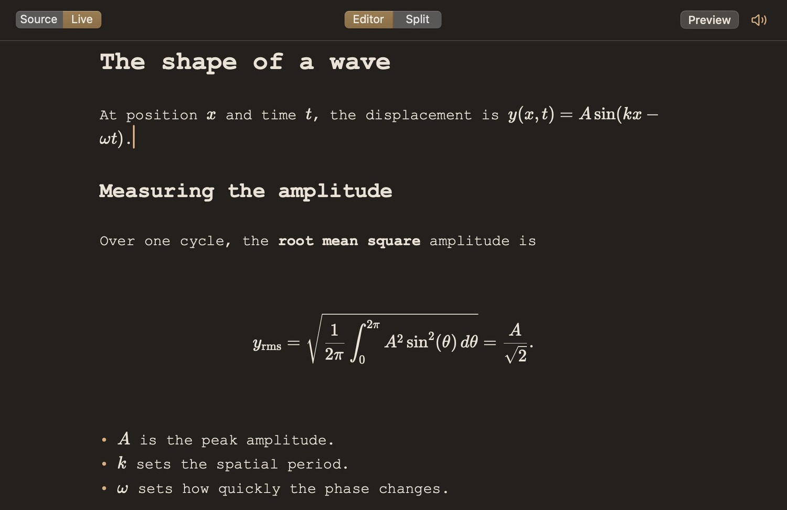

# Ribbon

Ribbon is an open-source macOS typewriter for Markdown and LaTeX notes. It opens to a quiet writing surface in 17-point Courier New, with a macOS monospaced fallback. Typing, Space, Backspace, and Return have distinct sounds. Use the speaker button to mute them. In **Ribbon → Settings** (⌘,), choose **Soft** for a quieter, damped typewriter, **Classic** for a brighter clack and a full carriage return, or **Original** for Ribbon's synthesized sounds. Five other presets use excerpts from individual machines: **Olympia**, **Hermes Baby**, **Olivetti**, **Smith-Corona Corsair**, and the electric **IBM Selectric II**. The recordings were cut into individual clips and level-matched. Some Space, Backspace, and Return sounds use similar taps or mechanism movements from that same machine when those keys were unlabeled in the recording. The play button samples the selected style at your current volume.

Under **Mechanical Keyboards** in the Sound menu, **Rainy 75 (Creamy)** offers rounded, deeper taps, **Cherry MX Blue** has sharp clicks, and **Cherry MX Red** has a lighter bottom-out. Each draws from a different mechanical keyboard recording. For keys that were unlabeled in the source, Ribbon uses a similar tap from the same keyboard.



## Run

Download **Ribbon-macOS.zip** from [GitHub Releases](https://github.com/yvhem/ribbon-typewriter/releases/latest), unzip it, and move **Ribbon.app** to Applications. Ribbon targets macOS 14 or later and ships as a universal build for Apple silicon and Intel. The release is ad-hoc signed and has no Apple notarization. If macOS blocks it on your machine, build it locally using the steps below.

Choose **File → Open** and select **Sample.md**, then use **⌘2** to see the source and rendered page side by side. Documents are ordinary UTF-8 Markdown files. Name and place a new file with **⌘S**. Named documents autosave in place after edits, and macOS handles recovery for untitled drafts.

## Editing styles and layouts

**Source** shows plain Markdown. **Live** renders headings, emphasis, blockquotes, links, unordered-list markers, inline code, and equations in the editor. Move into a styled span or line to reveal its Markdown markers. Click a rendered equation to edit its LaTeX.

Both styles offer **Editor** and **Split**. Split pairs the chosen editor with the rendered document. Use the separate **Preview** button for a reading view, and click it again to return to the previous layout. The bottom-right button enters or exits Focus Mode.

## Equations

Use `$x^2$` or `\(x^2\)` for inline math. Put display delimiters on separate lines, or on the same line if the whole block fits there.

```markdown
$$
\int_0^\infty e^{-x^2}\,dx = \frac{\sqrt{\pi}}{2}
$$
```

Display blocks also accept `\[` and `\]`. Dollar signs meant as text can be written as `\$`. Math inside Markdown code spans and fenced code remains literal. Invalid TeX appears in a different color in the preview, with the parser message available on hover. See the [KaTeX supported functions](https://katex.org/docs/supported.html) for syntax. The preview runs offline and shows Markdown image descriptions as text. Web and email links open in the default app when clicked.

## Shortcuts

| Action | Shortcut |
| --- | --- |
| New / Open / Save | ⌘N / ⌘O / ⌘S |
| Undo / Redo / Find | ⌘Z / ⇧⌘Z / ⌘F |
| Editor / Split / Toggle Preview | ⌘1 / ⌘2 / ⌘3 |
| Source / Live | ⌥⌘4 / ⌘4 |
| Focus Mode / Exit Focus Mode | ⇧⌘F / Esc |
| Insert inline / display equation | ⌥⌘M / ⌥⇧⌘M |
| Toggle typing sounds | ⇧⌘K |
| Bigger / smaller / default editor text | ⌘= / ⌘- / ⌘0 |
| Settings | ⌘, |

Equation shortcuts surround the current selection with delimiters, or place the cursor between them. Split view stacks the panes in narrow windows.

## Build from source

Install Xcode 15 or later and select it as the command-line developer tool. From this project's folder, run:

```sh
./build-app.sh
open dist/Ribbon.app
```

Use **./build-app.sh --universal** to build for both Apple silicon and Intel. **Package.swift** can also be opened in Xcode for editing. Launch the app bundle made by the build script to use macOS document registration.

The editor uses SwiftUI and AppKit. Audio plays through AVFoundation. The preview uses WebKit with bundled [markdown-it 15.0.3](https://github.com/markdown-it/markdown-it) and [KaTeX 0.18.10](https://github.com/KaTeX/KaTeX/releases/tag/v0.18.10), including KaTeX's math fonts. The upstream licenses are in the preview's vendor folder. The app uses the system's editor font and bundles its own icon, synthesized WAVs, and edited CC0 typewriter and mechanical keyboard recordings. Audio credits are included in the Audio resources.

Live uses bundled [CodeMirror](https://codemirror.net/) components, [Lezer’s Markdown parser](https://github.com/lezer-parser/markdown), and the same offline math renderer as Preview. The npm lockfile and vendor entry point in **Support/LiveEditor** are for maintaining the bundled editor. Swift builds use the checked-in browser bundle directly.

## License

Ribbon's code is licensed under the [MIT License](LICENSE). The bundled editor and renderers retain their upstream licenses, and the [recording credits](Sources/Ribbon/Resources/Audio/Credits.txt) identify the CC0 sound sources.
